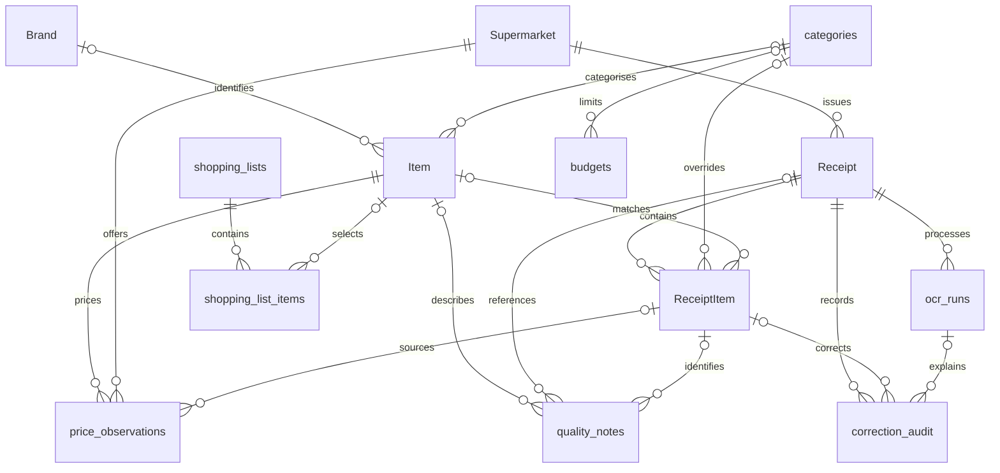

# SQLite Database

The schema implements the README's grocery receipt processing, grocery spending
analytics, supermarket price history, quality notes, grocery shopping lists,
and optional monthly grocery budgets.
It uses Python's standard-library `sqlite3`; no database server or additional
Python packages are required.

## Grocery scope

The current module handles grocery only. All active business tables and views
share this scope; there is no general expense-type model or selector. Other
personal spending domains are outside the current implementation.

`categories` holds grocery product groups such as produce, dairy, and grains.
An overall budget means the total grocery budget for its month and currency.
The database does not infer whether a purchase is grocery from product text;
the future ingestion/review workflow must keep inputs within this module's scope.

`source_type` records an input source, `price_type` records regular/promotional/
loyalty pricing, and `issue_type` records a product quality issue. These fields
remain useful within grocery and do not introduce other expense domains. See
the [data structure reference](../data/README.md#schema-overview) for their values.

## Initialise and verify

Run from the repository root:

```bash
python -m spending.database
python -m unittest discover -s tests -v
```

The default database is `data/spending.db`. To use another location:

```bash
python -m spending.database --path /tmp/personal-spending.db
```

New databases are created directly from the consolidated
[`sql/schema.sql`](../sql/schema.sql). Re-running initialisation preserves an
existing complete database. During development, schema changes are applied by
rebuilding the local database from this canonical file.

The final schema uses the active table names: `Supermarket`, `Item`, `Receipt`,
and `ReceiptItem`. It also uses
`supermarket_id`, `supermarket_name`, and `v_supermarket_spending` for related
columns and reporting. The extended schema's other field names are unchanged.
## Tables

For the complete field lists with `*` primary-key and `-` foreign-key notation,
see the [data structure reference](../data/README.md).

| Table | Data and relationships |
|---|---|
| `Supermarket` | Retailer name, location, and store format; unique name/location pair |
| `Brand` | Case-insensitive unique manufacturer or supermarket own-brand name; common UK brands are seeded during setup |
| `categories` | Case-insensitive unique grocery product group names |
| `Item` | Standardised name, optional brand/category/barcode, pack size and unit |
| `Receipt` | Retailer, purchase date, currency, totals, file path/hash, source and verification status |
| `ReceiptItem` | Receipt line number, original description, optional matched product/category, quantity, prices and discounts |
| `price_observations` | Product, retailer, currency, package price, snapshot size/unit, observation time, regular/promotion/loyalty type, source URL or receipt item |
| `quality_notes` | Product or receipt issue; optional receipt item; packaging/spoilage/expiry/other |
| `ocr_runs` | Receipt, engine/version, processing status, raw output, confidence and error details |
| `correction_audit` | Receipt and optional item/OCR run, field, before/after values, editor and timestamp |
| `shopping_lists` | Name, active/completed/archived status and creation time |
| `shopping_list_items` | List, optional product, description, quantity and purchased flag |
| `budgets` | Month, currency, optional grocery product group and budget amount; null category means overall grocery budget |



## Storage and validation rules

- The OCR service writes attempts to `ocr_runs`, with JSON text/pages/parsed
  suggestions in `raw_output`, and leaves the receipt as `needs_review`.
  `ReceiptItem`, product and supermarket rows are created only after verification.
  Failed retries create new attempts and preserve earlier ones. See [OCR behaviour](ocr.md).
- Monetary fields ending in `_pence` store integer pence: `325` means
  GBP 3.25. Currency defaults to GBP but is explicitly stored. Codes must be
  three uppercase letters; the application must validate supported currencies
  and their minor-unit scales. Use decimal arithmetic at input boundaries.
- Receipt dates use `YYYY-MM-DD`; budget months use `YYYY-MM`. Creation and
  audit timestamps default to UTC. Supply observation times in UTC ISO 8601.
- A receipt can be incomplete during OCR. `verified` requires a retailer,
  valid purchase date, and nonnegative total. Only verified receipts contribute
  to spending views. Application validation must reconcile totals and check
  the completeness of OCR results before setting this status.
- `file_sha256` is a unique lowercase SHA-256 digest of the original file.
  The upload service must calculate it; the database does not read files.
  This detects identical files, not different photos of the same receipt.
- `ReceiptItem.unit_price_pence`, `discount_pence`, and `original_pence` preserve
  individual amounts visible on the receipt and confirmed by OCR or manual
  review. Matching and reconciliation may use arithmetic but never write a sum,
  difference, or inferred value into these fields. The after-discount amount is
  derived only when needed. `Receipt.voucher_pence` records a voucher deducted
  from the entire receipt; `adjustment_pence` is a signed receipt-level change.
- Quantities and pack sizes must be positive. Pack units are `g`, `kg`, `ml`,
  `l`, or `item`; size and unit must be supplied together or both omitted.
- A price observation represents one package's price, not an entire receipt
  line's total. Size/unit are captured on the observation to preserve history.
  Receipt sources require a receipt item; online sources require a URL.
  The application must validate that receipt-derived prices match the item's
  product, retailer, currency, quantity, and discount allocation.
- Composite foreign keys prevent correction and quality-note item references
  from pointing to a different receipt. Receipt history uses restrictive
  deletion rules. Deleting a shopping list deletes its list items.
- Correction history is stored explicitly; direct SQL updates do not create
  audit entries. Update a corrected field and insert its audit record in the
  same transaction. The future API must enforce access control and audit policy.

## Analytics views

| View | Purpose |
|---|---|
| `v_monthly_spending` | Verified receipt count and total by month and currency |
| `v_supermarket_spending` | Verified spending by month, currency and retailer |
| `v_category_spending` | Verified item spending by month, currency and category |
| `v_receipt_reconciliation` | Item sum minus receipt discount and voucher plus adjustment, compared with receipt total |
| `v_product_price_history` | Price observations with product/retailer names and normalised unit price |
| `v_budget_vs_actual` | Overall/category monthly budgets, actual spending and remaining amount |

Category spending uses an item's category override first, then the product's
current category, then `Uncategorised`. Receipt-level discounts and adjustments
are not allocated across categories, so category totals can differ from receipt
totals. Changing a product's category affects historical category reporting unless
the items have explicit category overrides.

Unit prices are decimal pence per kilogram, litre, or item. A 500 g pack
priced at 250 pence has `unit_price_pence = 500.0` and `unit_basis = 'kg'`.
Missing package information yields a null unit price. Compare only compatible
units and currencies, and account for observation time and price type. Product
equivalence across brands is an application responsibility.

Example for Pandas, a backend service, or a script:

```python
from contextlib import closing
from spending.database import connect

with closing(connect()) as db:
    rows = db.execute(
        'SELECT month, total_pence FROM v_monthly_spending WHERE currency = ?',
        ('GBP',),
    ).fetchall()
    for row in rows:
        print(dict(row))
```

Use this connection helper for application writes: foreign-key enforcement is
enabled per connection. External SQL tools must run `PRAGMA foreign_keys = ON`
before writing. Power BI can query the views using a separately configured
SQLite connector/ODBC driver; a Power BI report is not created by initialisation.

